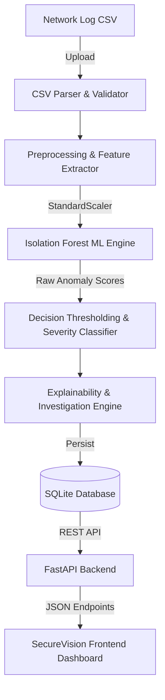

# SecureVision AI — AI-Based Security Log Analyzer
## Explainable Machine Learning Anomaly Detection System for Network Security


---

## 1. Project Overview

**SecureVision AI** is an end-to-end, full-stack cybersecurity application designed for automated network traffic analysis and anomaly detection. Traditional signature-based Intrusion Detection Systems (IDS) often fail when encountering novel zero-day attacks or stealthy multi-stage intrusions. SecureVision AI bridges this gap using an unsupervised **Isolation Forest** machine learning pipeline paired with a rule-augmented **Explainable AI (XAI)** engine.

### Key Capabilities
- **Unsupervised Anomaly Detection**: Detects zero-day threats, port scans, brute force attacks, and data exfiltration without requiring pre-labeled attack data.
- **Explainable AI (XAI)**: Generates human-readable explanations and identifies the top contributing features for every flagged anomaly.
- **Actionable Incident Response**: Generates contextual investigation checklists and mitigation steps for security analysts.
- **Interactive SOC Dashboard**: Real-time KPI counters, threat distribution charts (Chart.js), alert filtering, CSV export, and model lifecycle management.
- **Research & Benchmark Suite**: Reproducible evaluation scripts outputting precision, recall, F1-score, and confusion matrices against holdout data.

---

## 2. System Architecture



### Component Breakdown
1. **Frontend**: Single-page application (SPA) built with semantic HTML5, modern CSS3 (custom design system with glassmorphism), and vanilla JavaScript. Features dynamic Chart.js visualizations, real-time alert filters, and modal incident breakdowns.
2. **Backend**: High-performance asynchronous API built using **FastAPI** and **Pydantic v2**, with background file processing and robust error handling.
3. **Database**: **SQLite** with **SQLAlchemy 2.0 ORM** supporting transactional scan persistence, alert queries, pagination, and research metrics.
4. **Machine Learning Pipeline**:
   - Scaler: `StandardScaler` (centers numeric flow telemetry to zero mean and unit variance).
   - Algorithm: `IsolationForest` (100 estimators, contamination factor 0.1).
   - Severity Grading: Low, Medium, High, and Critical based on standard score percentiles.

---

## 3. Directory Structure

```text
log analyzer/
├── backend/
│   ├── routes/
│   │   └── api.py              # REST API endpoints (scans, alerts, summary, models)
│   ├── services/
│   │   ├── detector.py         # Isolation Forest model training, inference, persistence
│   │   ├── evaluation.py       # Precision, Recall, F1, Confusion Matrix metrics
│   │   ├── explanations.py     # Feature attribution and investigation step generator
│   │   ├── parser.py           # Robust CSV parser with column mapping & sanitization
│   │   └── preprocessing.py    # StandardScaler and data cleaning pipeline
│   ├── tests/
│   │   ├── conftest.py         # Pytest fixtures and test database isolation
│   │   └── test_api.py         # Comprehensive API, ML, and integrity regression tests
│   ├── config.py               # Application configuration and feature definitions
│   ├── database.py             # SQLAlchemy models (Scan, Alert, ModelMetadata, ExperimentResult)
│   ├── main.py                 # FastAPI application factory and static file mounts
│   └── schemas.py              # Pydantic validation schemas
├── data/
│   └── sample_logs.csv         # Realistic benchmark network dataset (880 events)
├── frontend/
│   ├── app.js                  # Frontend controllers, event handlers, and API client
│   ├── index.html              # Main dashboard UI
│   └── styles.css              # Custom responsive stylesheet
├── models/
│   ├── feature_metadata.json   # Mean, std, and percentile metrics for feature attribution
│   ├── isolation_forest.joblib # Serialized Isolation Forest model
│   ├── model_metadata.json     # Hyperparameters, timestamp, and training statistics
│   └── scaler.joblib           # Serialized StandardScaler
├── research/
│   └── results/                # Benchmark JSON evaluation results
├── scripts/
│   ├── evaluate_model.py       # Evaluation and benchmarking CLI
│   ├── generate_dataset.py     # Synthetic security dataset generator
│   └── train_model.py          # Standalone training script
├── requirements.txt            # Python dependencies
├── security_analyzer.db        # SQLite database
└── README.md                   # Project documentation
```

---

## 4. Supported Network Features

The parser automatically maps heterogeneous network log columns to 19 standardized flow features:

| Feature Name | Description |
|---|---|
| `flow_duration` | Duration of the bidirectional flow (microseconds) |
| `total_fwd_packets` | Packets transmitted in forward direction |
| `total_bwd_packets` | Packets transmitted in backward direction |
| `total_length_of_fwd_packets` | Total bytes in forward direction |
| `total_length_of_bwd_packets` | Total bytes in backward direction |
| `fwd_packet_length_mean` | Average packet size in forward direction |
| `bwd_packet_length_mean` | Average packet size in backward direction |
| `flow_bytes_per_s` | Throughput rate (bytes/second) |
| `flow_packets_per_s` | Packet rate (packets/second) |
| `fwd_iat_mean` | Mean inter-arrival time between forward packets |
| `bwd_iat_mean` | Mean inter-arrival time between backward packets |
| `flow_iat_mean` | Mean flow inter-arrival time |
| `active_mean` | Mean time flow was active before going idle |
| `idle_mean` | Mean time flow was idle before becoming active |
| `syn_flag_count` | Count of SYN flag occurrences |
| `ack_flag_count` | Count of ACK flag occurrences |
| `psh_flag_count` | Count of PSH flag occurrences |
| `rst_flag_count` | Count of RST flag occurrences |
| `fin_flag_count` | Count of FIN flag occurrences |

---

## 5. Quick Start Guide

### Prerequisites
- Python 3.10+ (Python 3.11 recommended)
- Modern web browser (Chrome, Edge, Firefox)

### Installation

1. **Activate Virtual Environment**:
   ```powershell
   # Windows PowerShell
   .\venv\Scripts\Activate.ps1
   ```

2. **Install Dependencies** (already installed in workspace):
   ```bash
   pip install -r requirements.txt
   ```

3. **Start the Application**:
   ```powershell
   .\venv\Scripts\python -m uvicorn backend.main:app --host 127.0.0.1 --port 8000 --reload
   ```

4. **Open in Browser**:
   - Dashboard: [http://127.0.0.1:8000/](http://127.0.0.1:8000/)
   - API Docs: [http://127.0.0.1:8000/docs](http://127.0.0.1:8000/docs)

---

## 6. Running Tests & Benchmarks

### Execute Unit & Integration Tests (38 Tests)
```powershell
.\venv\Scripts\python -m pytest
```

### Generate Synthetic Security Logs
```powershell
.\venv\Scripts\python scripts/generate_dataset.py --output data/custom_logs.csv --samples 1500
```

### Retrain Model via CLI
```powershell
.\venv\Scripts\python scripts/train_model.py --data data/sample_logs.csv
```

### Run Model Evaluation & Benchmarking
```powershell
.\venv\Scripts\python scripts/evaluate_model.py --data data/sample_logs.csv
```

---

## 7. API Reference

| Method | Endpoint | Description |
|---|---|---|
| `GET` | `/health` | Service health, database connectivity, and model status |
| `GET` | `/api/v1/summary` | Aggregated dashboard KPI counters and severity distributions |
| `POST` | `/api/v1/scans` | Upload and analyze a network log CSV |
| `GET` | `/api/v1/scans` | Paginated list of historical scans |
| `GET` | `/api/v1/scans/{id}` | Detailed scan summary with feature breakdowns |
| `GET` | `/api/v1/alerts` | Paginated alerts with filters (`severity`, `prediction`, `scan_id`) |
| `GET` | `/api/v1/alerts/{id}` | In-depth alert details with XAI explanation and investigation steps |
| `GET` | `/api/v1/alerts/export` | Export filtered alerts as a downloadable CSV |
| `GET` | `/api/v1/model/status` | Model training metadata, features, and hyperparameters |
| `POST` | `/api/v1/model/train` | Trigger model retraining on an uploaded dataset |
| `GET` | `/api/v1/research/metrics` | Model evaluation benchmarks and confusion matrices |

---

## 8. B.Tech CSE Viva Voce Preparation Guide

### Q1: Why use Isolation Forest instead of Supervised Learning (e.g., Random Forest)?
> **Answer**: In cybersecurity, network intrusions and zero-day attacks continuously evolve. Supervised models only detect patterns present in historical training labels and suffer from acute class imbalance (benign traffic vastly outweighs attack traffic). Isolation Forest is an unsupervised algorithm that isolates anomalies based on the principle that anomalies are few and structurally different, enabling the detection of previously unseen attack signatures.

### Q2: How does Isolation Forest mathematically isolate anomalies?
> **Answer**: Isolation Forest builds an ensemble of isolation trees (iTrees). In each tree, features are selected at random, and a random split value between the min and max values is chosen. Because anomalous data points have extreme or atypical values, they require fewer random partitions to be isolated compared to normal clustered points. The anomaly score is a function of the average path length $h(x)$ across the ensemble of trees.

### Q3: Why is StandardScaler used and how is preprocessing structured?
> **Answer**: Network traffic datasets feature disparate measurement units (flow durations in microseconds, byte volumes reaching gigabytes, and flag counters between 0 and 10). `StandardScaler` standardizes each feature to zero mean ($\mu = 0$) and unit variance ($\sigma = 1$), ensuring that random axis-aligned partitions in Isolation Forest treat all 19 dimensions on equal mathematical footing. Preprocessing scrubs invalid values by replacing infinite rates (`np.inf`) with `NaN` and imputing missing fields with column medians. Training-set statistical parameters ($\mu, \sigma, Q_{25}, Q_{75}$) are saved in `feature_metadata.json` for downstream Explainable AI (XAI) feature attribution.

### Q4: How is Explainable AI (XAI) achieved in this project?
> **Answer**: For each flagged event, the system calculates the z-score deviation of each feature relative to the baseline distribution established during training. The engine identifies the top contributing features that caused the anomaly score to exceed the threshold, compares them against statistical reference percentiles, and provides human-readable explanations alongside targeted incident response procedures (e.g., checking firewall logs for SYN floods, inspecting DNS queries for exfiltration).

---

## 9. Academic Disclaimer

This project is an academic research demonstration developed for B.Tech Computer Science Engineering. While designed with industry best practices, flagged anomalies indicate statistical deviations in network telemetry and should be corroborated by human security analysts prior to enforcing automated network containment.
